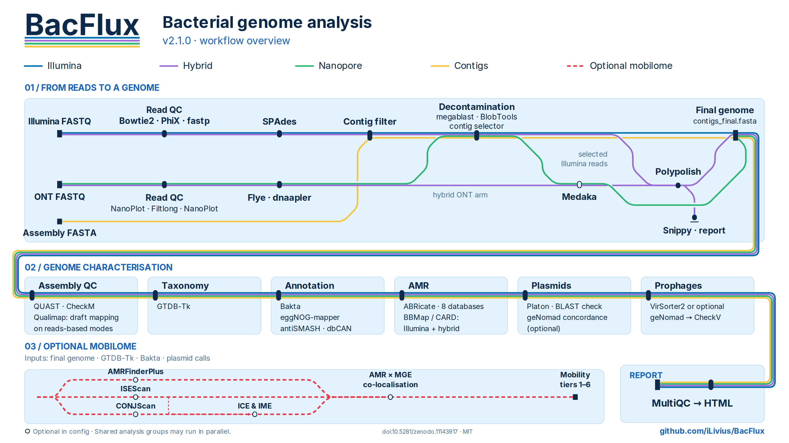

# BacFlux

```
________             _______________
___  __ )_____ _________  ____/__  /___  _____  __
__  __  |  __ `/  ___/_  /_   __  /_  / / /_  |/_/
_  /_/ // /_/ // /__ _  __/   _  / / /_/ /__>  <
/_____/ \__,_/ \___/ /_/      /_/  \__,_/ /_/|_|

v2.1.0
```

**A unified Snakemake workflow for Illumina, Nanopore, hybrid data or existing bacterial assemblies, integrating decontamination, quality control, taxonomy, annotation, AMR gene detection and mobilome analysis.**


[](https://doi.org/10.5281/zenodo.11143917)

<!-- Workflow overview as a metro map, one coloured line per mode. GitHub shows the dark version to readers in dark mode and the light one otherwise. The detailed map is on the documentation home page (docs/index.md). -->
<p align="center"><picture><source media="(prefers-color-scheme: dark)" srcset="docs/assets/bacflux_overview_dark.png"></picture></p>

The detailed map, step by step, is on the [documentation home page](https://iLivius.github.io/BacFlux/).

## 📖 Documentation

**Full documentation: [iLivius.github.io/BacFlux](https://iLivius.github.io/BacFlux/)**

| | |
|---|---|
| [Installation](https://iLivius.github.io/BacFlux/getting-started/installation/) | the launcher environment, and the few tools BacFlux expects to find |
| [Reference databases](https://iLivius.github.io/BacFlux/getting-started/databases/) | what to download, what the workflow fetches, what you can point at a copy of |
| [Quick start](https://iLivius.github.io/BacFlux/getting-started/quick-start/) | clone to finished run, in one page |
| [Choosing a mode](https://iLivius.github.io/BacFlux/getting-started/choosing-a-mode/) | which mode a dataset belongs in, and what a wrong one does |
| [Modes](https://iLivius.github.io/BacFlux/modes/) | the four front ends, one page each |
| [Analysis stages](https://iLivius.github.io/BacFlux/analysis/decontamination/) | decontamination, QC, taxonomy, annotation, AMR, plasmids, prophages |
| [Mobilome module](https://iLivius.github.io/BacFlux/mobilome/) | activation, mobility tiers, outputs and interpretation limits |
| [Configuration](https://iLivius.github.io/BacFlux/reference/configuration/) | every key, which modes read it, its default and its trade-off |
| [Output files](https://iLivius.github.io/BacFlux/reference/output/) | what each stage writes, and which files are the deliverables |
| [Running BacFlux](https://iLivius.github.io/BacFlux/reference/running/) | dry runs, the CPU budget, restarting an interrupted run |
| [Troubleshooting](https://iLivius.github.io/BacFlux/troubleshooting/) | the failures worth knowing about in advance |
| [Coming from v1](https://iLivius.github.io/BacFlux/getting-started/from-v1/) | the `mode` key, the config to rebuild, the renumbered output |

This README is deliberately short: it covers what BacFlux is and how to get a first run
going. Everything else — parameter reference, per-mode guidance, output semantics, the
mobilome module and the methodological caveats — lives on the documentation site.

## Synopsis

BacFlux is a [Snakemake](https://snakemake.github.io/) workflow that takes a bacterial
isolate from raw reads — or from a genome somebody else assembled — through assembly,
decontamination, quality control, taxonomic placement, functional annotation, and
screening for resistance genes, virulence factors, plasmids and prophages. One key in the
config file, `mode`, decides which of four front ends runs:

| `mode:` | Input | Front end |
|---|---|---|
| `illumina` | Illumina paired-end reads | PhiX removal, `fastp`, `SPAdes` |
| `nanopore` | Long reads from Oxford Nanopore Technologies (ONT) | `NanoPlot`, `Filtlong`, `Flye`, `dnaapler`, `Medaka`\* |
| `hybrid` | Illumina and ONT reads from the same isolate | both front ends above, then the ONT assembly corrected with the short reads by `Polypolish`, and a `Snippy` comparison of the two assemblies |
| `contigs` | A finished assembly (FASTA) | contig filtering only — no assembler |

BacFlux was developed to support the genomic characterisation of bacterial strains
considered for biocontrol, biostimulant and biofertiliser applications. Its annotation
and screening results help assess candidate strains, including the presence of
resistance-associated and virulence-associated genes. These predictions support
strain selection alongside phenotypic evidence and application-specific assessment.

Each mode produces `contigs_final.fasta` for a shared set of downstream analyses.
Common processing improves consistency across datasets, while sequencing quality,
assembly fragmentation and available read types still affect the results.

```
  config: mode ──> ┌──────────┬──────────┬──────────┬──────────┐
                   │ illumina │ nanopore │  hybrid  │ contigs  │
                   └────┬─────┴────┬─────┴────┬─────┴────┬─────┘
  01.reads         bowtie2 PhiX  NanoPlot    both legs   —
                   fastp         Filtlong
  02.assembly      SPAdes        Flye        Flye, Medaka*,   contig filter,
                                 dnaapler    Polypolish,      header-aware
                                 Medaka*     Snippy
                        │            │            │           │
                        └────────────┴─────┬──────┴───────────┘
                                           ▼
                       02.assembly/{sample}/contigs_final.fasta

  03.taxonomy      GTDB-Tk against GTDB R232
  04.annotation    Bakta · eggNOG · antiSMASH · dbCAN
  05.amr           ABRicate over eight databases · reads mapped to CARD †
  06.plasmids      Platon, with a supplementary BLAST line beside each call
  07.phages        VirSorter2 (or geNomad*) → CheckV
  08.mobilome      AMRFinderPlus · ISEScan · CONJscan → a mobility tier per AMR gene *
  09.report        MultiQC — one page for the whole batch

  Decontamination (BLAST + BlobTools) and assembly QC (QUAST, CheckM, Qualimap) are
  shared code as well; both sit inside 02.assembly, where each front end needs them.

  * optional, set in the config          † modes that have short reads
```

**The mobilome module** (`08.mobilome`, disabled by default) assesses the genomic
context and potential mobility of resistance genes. It combines AMRFinderPlus
results with mobile-element evidence and assigns a tier from
`intrinsic_candidate` to `predicted_self_transmissible`, and records the reason for
every gene left without mobile-element context. These predictions require
interpretation with their confidence fields and assembly limitations; they do not
demonstrate transfer or establish intrinsic resistance. See
[the mobilome module](https://iLivius.github.io/BacFlux/mobilome/).

v2.0.0 brings together the four workflows that grew out of BacFlux — `BacFlux` for
Illumina reads, `FastaFlux` for finished assemblies, `BacFluxL` for ONT reads and
`BacFluxL+` for both — as one mode each. The earlier repositories retain their DOIs and
remain citable for work performed with those versions. If you are coming from one of
them, start at
[Coming from v1](https://iLivius.github.io/BacFlux/getting-started/from-v1/).

`BacFlux` belongs to the [BioFlux](https://github.com/stars/iLivius/lists/bioflux) family of pipelines.

## Quick start

```bash
# 1. Clone
git clone https://github.com/iLivius/BacFlux.git
cd BacFlux

# 2. Create the launcher environment (Snakemake 9.14.6 and nothing else)
conda create -n snakemake -c conda-forge -c bioconda snakemake=9.14.6
conda activate snakemake

# 3. Copy the shipped config and edit the copy: `mode`, the input directory for
#    that mode, `output_dir`, and the five database paths below.
#    config/config_custom.yaml is git-ignored, so your edits survive a `git pull`.
cp config/config.yaml config/config_custom.yaml

# 4. Dry-run to check the plan, then execute
snakemake --sdm conda --configfile config/config_custom.yaml --cores 24 -n
snakemake --sdm conda --configfile config/config_custom.yaml --cores 24
```

Run both commands from the repository root: `workflow/Snakefile` is found there
automatically, which is why it never appears on the command line. Only Snakemake is
installed by hand — `--sdm conda` (software-deployment-method) tells it to build each
rule's own conda environment on first use, so every analysis tool is provisioned for
you. Standard Unix utilities such as `awk` and `grep` come from the system; see
[Installation](https://iLivius.github.io/BacFlux/getting-started/installation/#4-the-tools-bacflux-expects-to-find-and-does-not-install).

For a local run, `--cores N` sets the CPU budget allocated through the rules'
`threads:` declarations. Do not add `--jobs`/`-j`: for a local run Snakemake then
stops enforcing the core budget. See
[Running BacFlux](https://iLivius.github.io/BacFlux/reference/running/).

Always dry-run first. Nearly all of BacFlux's validation happens while the plan is being
built, so `-n` costs seconds and catches a wrong mode, a missing input directory or a bad
sample name before the first job starts — and its header names the mode, the phage caller,
the decontamination policy and whether the mobilome module is on.

**Five databases must be on disk before the first run.** They are too large, or too tied to
one release, for the workflow to fetch:

| Config key | Database | Version |
|---|---|---|
| `directories.bakta_db` | [Bakta](https://github.com/oschwengers/bakta?tab=readme-ov-file#database) | **v6.0** |
| `directories.blast_db` | [NCBI core nt](https://ftp.ncbi.nlm.nih.gov/blast/db/) and taxonomic files | — |
| `directories.eggnog_db` | [eggNOG](https://github.com/eggnogdb/eggnog-mapper/wiki) diamond database | **v5.0.2** |
| `directories.gtdbtk_db` | [GTDB](https://ecogenomics.github.io/GTDBTk/installing/index.html) | **R232** |
| `directories.platon_db` | [Platon](https://github.com/oschwengers/platon?tab=readme-ov-file#database) | **v1.5.0** |

The database versions must remain compatible with the pinned tools. The eggNOG release
is fixed by the pinned eggnog-mapper 2.1.15, which builds its own download URL, so the
database cannot drift away from the tool. And the Platon database is versioned
separately from Platon itself — v1.5.0 is the current database for every Platon from
1.5.0 onwards, including the 1.8 this workflow pins, so the two numbers are meant to
differ.

Everything else — PhiX, CARD, CheckV, dbCAN, VirSorter2, antiSMASH, and the optional
mobilome databases — is downloaded into `output_dir` on the first run that needs it, or
all at once with `snakemake download_all`. Most of those also take a `directories.*_db`
key: point it at a copy you already hold and nothing is fetched. Download recipes, disk
sizes and every optional key are on
[reference databases](https://iLivius.github.io/BacFlux/getting-started/databases/).

## Output

Everything lands under `directories.output_dir`, in one numbered directory per stage —
`01.reads` through `09.report`, in the order they run, with the same numbering in all four
modes. The delivered genome is always `02.assembly/{sample}/contigs_final.fasta`, and the
shared stages from `03` onwards analyse that genome. Beside it,
`contaminants/contig_taxonomy_decisions.tsv` records every contig that was kept or dropped
and why — as does every other filtering step in BacFlux. What each stage holds, file by
file, is on [output files](https://iLivius.github.io/BacFlux/reference/output/).

## Citation

> Antonielli, L., Großkinsky, D. K., Koch, H., Trognitz, F., Sanchez Mejia, A., & Nagel, M.
> (2024). *BacFlux: A workflow for bacterial short-read assembly, QC, annotation, and more.*
> Zenodo. <https://doi.org/10.5281/zenodo.11143917>

That DOI is the concept DOI and always resolves to the newest release; each tagged release
also gets its own version DOI, which is the one to cite when the exact code matters.
Machine-readable metadata is in [`CITATION.cff`](CITATION.cff).

Most of the science BacFlux reports is produced by other people's tools and databases, so
**cite those too**. The full list is in [`CITATIONS.md`](CITATIONS.md) and on
the [citation page](https://iLivius.github.io/BacFlux/about/citation/).

## Acknowledgements

This work was originally supported by the
[Austrian Science Fund (FWF)](https://www.fwf.ac.at/en/) under Project I6030-B.

Much of v2.0.0 — merging the four workflows into one, building the mobilome module and
writing the documentation — was done with [Claude Code](https://claude.com/claude-code).
Anthropic provided six months of Claude Max through their Open Source programme, and the
scale of the v2 rewrite would not have been realistic without it.

## License

BacFlux is released under the [MIT License](LICENSE). The repository ships code and URLs
and no third-party data: every database is either one you already hold or one the workflow
fetches for you, from its publisher, under that publisher's terms. The tools, model sets and
databases BacFlux invokes carry their own licences — the types are listed, with the date
each was read, on [licensing](https://iLivius.github.io/BacFlux/about/licensing/).
