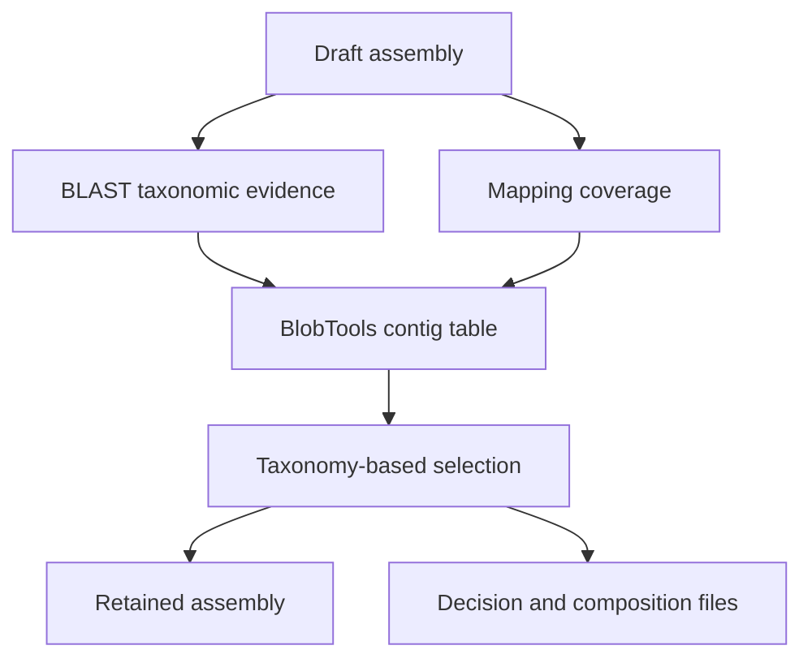

# Decontamination

BacFlux screens the draft assembly for contigs assigned to genera other than the
intended isolate. The purpose is to reduce contamination before taxonomic
classification, annotation and downstream analyses. Contaminant sequences can
affect completeness and contamination estimates, taxonomic assignments, and the
reported genes, plasmids and prophages.

**Contig selection is based on taxonomic assignment, not coverage.** BacFlux
combines BLAST-based taxonomy and mapping coverage in a BlobTools table. A
configurable policy then determines which contigs to retain. Coverage is recorded
for inspection but does not enter the selection decision. Each decision is written
to an audit file.

Genus-level assignment is evidence for filtering, rather than proof that a contig
belongs to a contaminant. In particular, genuine plasmids can be assigned to a
genus different from their host. Review the removed contigs before interpreting
the final assembly or the absence of a gene or plasmid.

## Inputs and mode-specific behaviour { #where-it-sits-in-each-mode }

The primary screen runs in all four workflow modes. Its position and effect depend
on the assembly being analysed.

| Workflow mode | Assembly screened | Retained sequences | Subsequent use |
|---|---|---|---|
| `illumina` | Filtered SPAdes draft, `contigs_filt.fasta` | `contigs_final.fasta` | Final assembly for downstream analyses |
| `contigs` | Filtered input assembly, `contigs_filt.fasta` | `contigs_final.fasta` | Final assembly for downstream analyses |
| `nanopore` | Flye assembly after reorientation with dnaapler | `contaminants/assembly_decontam.fasta` | Medaka polishing, if enabled, followed by finalisation as `contigs_final.fasta` |
| `hybrid` | Illumina SPAdes draft | `contaminants/contigs_sel.fasta` | Illumina comparator for QC and Snippy; extraction of the short reads used for correction and, optionally, long-read filtering |

Paths in the table are relative to `02.assembly/{sample}/`.

!!! note "The hybrid final assembly has a separate screen"

    In `hybrid` mode, filtering the Illumina draft does not directly filter the
    final assembly, which is assembled from the Nanopore reads. A second screen
    reports taxonomic decisions for `contigs_final.fasta` without changing its
    sequence. See [the second screen in `hybrid`](#the-second-screen-in-hybrid).

## Configure contig selection { #the-policy }

The settings are under `parameters.decontamination` in the configuration file.
The defaults select a dominant genus by its total sequence length and remove
contigs without a taxonomic assignment.

```yaml
parameters:
  decontamination:
    mode: auto
    auto_vote: bp
    discard_no_hit: true
    long_read_mode: "off"
    include_genera:
    include_genera_by_sample:
    exclude_genera:
    exclude_genera_file:
    sample_overrides:
```

The top-level `mode` selects the workflow input mode (`illumina`, `nanopore`,
`hybrid` or `contigs`). **`parameters.decontamination.mode` selects the filtering
policy.** These are separate settings.

| Filtering policy | Selection rule | Appropriate use |
|---|---|---|
| `auto` | Retain the dominant genus, selected using `auto_vote`, with the genus aliases described below | An isolate expected to be dominated by one genus |
| `include` | Retain contigs assigned to the listed genera, including applicable aliases | The target genus or genera are known |
| `exclude` | Remove contigs assigned to the listed genera; matching is exact | Specific contaminant genera are known |
| `off` | Retain all contigs and still write the audit files | Inspect assignments without removing sequence, or investigate possible over-filtering |

With `discard_no_hit: true`, contigs without a genus assignment are removed before
the `auto`, `include` or `exclude` policy is applied. They are also excluded from
the dominant-genus calculation in `auto` mode. The `off` policy retains all
contigs, including unclassified ones.

With `discard_no_hit: false`, unclassified contigs keep the label `no-hit` and are
judged by the active policy like any other assignment. `exclude` retains them
(reason `not_excluded_genus`); `auto` and `include` remove them
(`not_auto_genus:<genus>`, `not_included_genus`), because `no-hit` matches no genus
or alias. In `auto`, `no-hit` also takes part in the vote: if unclassified contigs
hold the largest share, `no-hit` is selected, every classified contig is removed and
`{sample}_kept_genus.txt` is empty. To retain unclassified contigs, combine
`discard_no_hit: false` with `exclude`, or use `off`. An unclassified contig may be
sequence with no close relative in `nt`, such as a small plasmid, rather than
contamination.

!!! warning "Keep `discard_no_hit` explicit"

    The supplied configuration sets `discard_no_hit: true`. Omitting the key
    entirely resolves to `false`, so deleting it changes the behaviour.

### How `auto` picks the genus

`auto_vote` determines how the dominant genus is selected from the BlobTools
assignments.

| `auto_vote` | Measure | Genus selected |
|---|---|---|
| `bp` (default) | Sum of contig lengths assigned to each genus | Greatest total sequence length |
| `contigs` | Number of contigs assigned to each genus | Greatest contig count |

For example:

| Contig | Assigned genus | Length |
|---|---|---:|
| `contig_1` | GenusA | 5,000,000 bp |
| `contig_2` | GenusB | 60,000 bp |
| `contig_3` | GenusB | 45,000 bp |
| `contig_4` | GenusB | 8,000 bp |

`bp` selects GenusA, with 5,000,000 bp compared with 113,000 bp for GenusB.
`contigs` selects GenusB, with three contigs compared with one, and can therefore
remove the chromosome. This is the reason for the length-based default. Either
setting can remove genuine plasmids assigned to a different genus; see
[plasmid retention](#route-1-bestsum-follows-database-composition-not-biology).

An exact tie is resolved alphabetically by genus name. The calculation is made
before applying genus aliases. With `discard_no_hit: true`, `no-hit` does not
participate in the calculation.

The log records the measure and selected genus, for example
`Auto vote by bp: kept genus GenusA.` The composition report records both measures
so that their agreement can be inspected.

The same measure is applied to the retained, genus-assigned contigs to choose the
genus written to `{sample}_kept_genus.txt`. This is passed to Bakta as a genus hint;
see [Annotation](annotation.md#the-genus-hint). The log records it as
`Genus given to Bakta: GenusA.`

### Genus aliases { #the-genus-aliases }

The selector uses a genus-alias table in `auto` and `include` modes to reduce
removal of contigs assigned to certain closely related genera. Aliases do not
apply to `exclude`: only the genera explicitly listed are excluded.

This table is a filtering safeguard. It does not reconcile the taxonomies of
NCBI, GTDB and LPSN, and should not be treated as a taxonomic classification.

### Settings for a batch or an individual sample { #which-keys-apply-to-every-sample-and-which-to-one }

| Key | Scope | Behaviour |
|---|---|---|
| `mode` | All samples, unless overridden | Primary filtering policy |
| `auto_vote` | All samples | Dominant-genus measure; also used for the Bakta genus hint |
| `discard_no_hit` | All samples, unless overridden | Handling of contigs without a taxonomic assignment |
| `long_read_mode` | All `hybrid` samples | Decision policy for the second screen; does not modify the final assembly |
| `include_genera` | All samples, unless overridden | Base list of genera to retain in `include` mode |
| `exclude_genera` | All samples, unless overridden | Base list of genera to remove in `exclude` mode |
| `exclude_genera_file` | All samples, unless overridden | File whose entries are added to `exclude_genera`; an override row's `exclude_genera` replaces both |
| `include_genera_by_sample` | Samples named in the file | Entries are added to that sample's include list |
| `sample_overrides` | Samples named in the file | Non-empty fields replace the corresponding settings for that sample |

`include_genera` and `exclude_genera` accept inline lists such as
`[Bacillus, Priestia]` or strings separated by semicolons, commas or tabs.
Whitespace around separators is removed. The other three genus-list/override
keys are **file paths**, not inline mappings.

Settings are resolved in this order:

1. Read the batch settings.
2. Add entries from `include_genera_by_sample` for the current sample.
3. Apply non-empty fields from its `sample_overrides` row.

### Configuration examples { #one-example-of-each }

The following examples show changes to make in a copy of the supplied
configuration. They are not complete configuration files.

**Retain known target genera throughout the batch.** For one genus, supply a
single name; for several, separate the names as shown.

```yaml
parameters:
  decontamination:
    mode: include
    include_genera: "Bacillus;Priestia;Peribacillus"
```

**Remove known contaminants.** An optional file extends the inline list.

```yaml
parameters:
  decontamination:
    mode: exclude
    exclude_genera: "Cutibacterium;Ralstonia"
    exclude_genera_file: /path/to/known_contaminants.txt
```

The file contains one genus per line. Blank lines and comments beginning with `#`
are ignored.

```text
# Additional contaminant genera
GenusB
GenusC
```

**Add genera for selected samples.** The file is tab-separated with columns
`sample` and `genus`. A sample may appear on multiple rows or have several genera
in one cell.

```yaml
parameters:
  decontamination:
    mode: include
    include_genera: "Bacillus"
    include_genera_by_sample: /path/to/extra_genera.tsv
```

```text
sample	genus
isolate1	Lysinibacillus
isolate2	Lysinibacillus;Brevibacillus
```

`isolate1` retains *Bacillus* and *Lysinibacillus*; `isolate2` retains *Bacillus*,
*Lysinibacillus* and *Brevibacillus*. Other samples retain *Bacillus* and its
aliases, such as *Priestia*, *Peribacillus* and *Paenibacillus*.

**Override a sample's policy or lists.** In `sample_overrides`, `sample` and
`mode` are required columns. `include_genera`, `exclude_genera` and
`discard_no_hit` are optional. Non-empty cells replace the existing setting;
empty cells leave it unchanged.

```yaml
parameters:
  decontamination:
    mode: auto
    sample_overrides: /path/to/overrides.tsv
```

```text
sample	mode	include_genera	exclude_genera	discard_no_hit
isolate3	off			
isolate4	include	Bacillus;Lysinibacillus		
isolate5	exclude		Cutibacterium	false
```

`isolate3` retains all contigs. `isolate4` uses an include list containing
*Bacillus* and *Lysinibacillus*, replacing any previous include list. `isolate5`
removes only contigs assigned to *Cutibacterium* and retains unclassified contigs.
Preserve the tab delimiters, including those around empty cells, when creating
this file.

!!! example "Adding to a list and replacing it have different effects"

    If the batch includes *Bacillus*, adding *Lysinibacillus* through
    `include_genera_by_sample` retains both genera for that sample. Setting
    `include_genera` to *Lysinibacillus* in `sample_overrides` replaces the list,
    so only *Lysinibacillus* and its applicable aliases are included.

## Method { #the-chain }

The primary screen is defined in `workflow/rules/shared/10_decontam.smk`. It
combines taxonomic evidence and coverage, then applies the selection policy.



### Taxonomic assignment { #2-taxonomy-megablast-against-ncbi-nt }

BLAST+ searches the draft contigs against the NCBI nucleotide database with
`megablast`. The output contains the matching taxonomy IDs, alignment statistics
and subject titles. `parameters.nt_version` selects the database subdirectory,
`core_nt` or `nt_prok`.

```yaml
parameters:
  nt_version: core_nt
```

The reference database and NCBI taxonomy files must be prepared as described in
[Reference databases](../getting-started/databases.md). BlobTools uses
`nodes.dmp` and `names.dmp` to resolve taxonomic assignments. Missing taxonomy
files stop the workflow before the corresponding jobs run.

### Coverage { #1-coverage-the-reads-mapped-back-onto-the-draft }

Mapping the sample's reads to the draft assembly provides per-contig read depth.
Differences in depth can help with inspection of possible contaminants, although
the selector does not use this information.

| Workflow mode | Mapping method |
|---|---|
| `illumina`, `hybrid` | Bowtie2 mapping of the paired-end Illumina reads |
| `nanopore` | minimap2 with the `map-ont` preset |
| `contigs` | minimap2 alignment of the contigs against themselves |

The mapping output is `contaminants/{sample}_map.bam` and its `.bai` index. These
are temporary files, retained until their dependent jobs finish. Where reads are
available, the mapping also supports [Qualimap](assembly-qc.md#mapping-quality-qualimap).

!!! warning "Self-alignment does not measure sequencing depth"

    In `contigs` mode, reads are unavailable. BacFlux aligns the assembly against
    itself to generate the BAM file required by BlobTools. This alignment does
    not provide independent read-depth evidence, so its coverage values should
    not be interpreted as sequencing depth. This mode has no Qualimap report.

### Combining the evidence { #3-blobtools-joins-coverage-and-taxonomy }

BlobTools combines contig length, GC content, coverage and taxonomic evidence.
Its `bestsum` rule sums BLAST bit scores by taxon to assign contigs at each
reported taxonomic rank. The selector uses the **genus** assignment from
`contaminants/bestscore.blob.blobDB.table.txt`.

This table is retained so that the evidence supporting the decisions can be
examined. Neither the coverage values nor the GC content determine which contigs
the selector retains.

### Applying the policy { #4-the-selector-keep-or-drop-with-a-reason-on-every-contig }

`select_contigs` runs
`workflow/scripts/10_decontam/select_contigs_by_taxonomy.py`. The script reads the
genus assignments, resolves the settings for each sample, applies the policy and
records the result for each contig in `contig_taxonomy_decisions.tsv`.

If no contigs are retained, the primary selection step fails. It writes the
decisions file before failing, so the reasons can be inspected instead of passing
an empty assembly to downstream analyses.

### BLAST of the final long-read assembly { #a-second-blast-in-the-long-read-modes }

In `nanopore` and `hybrid` modes, `blast_final_contigs` repeats the BLAST search on
`contigs_final.fasta` and writes `{sample}_final_blastout`. This provides BLAST
evidence with the contig identifiers used in the final assembly for the plasmid
stage's supplementary check.

In `hybrid` mode, the primary search used the Illumina draft, whose contig
identifiers differ from those in the Nanopore assembly. In `nanopore` mode,
polishing occurs after the primary search and may affect the headers. The second
search avoids relying on identifiers from the earlier assembly. It also supplies
the taxonomy for the hybrid final-assembly screen. In `illumina` and `contigs`
modes, the plasmid stage reuses the primary BLAST table.

## The second screen in `hybrid`

The final hybrid assembly is built from Nanopore reads, whereas the primary
selection step filters the Illumina draft. With
`parameters.hybrid.short_read_guidance: false` (the default), long-read filtering
uses length and quality without the decontaminated Illumina reads as a reference.
The primary taxonomic filter therefore does not remove contaminant long reads
before assembly.

A separate screen combines long-read coverage of `contigs_final.fasta` with the
final-assembly BLAST results. It uses the same selector, genus lists, aliases,
`auto_vote` and `discard_no_hit`, with its policy set by
`parameters.decontamination.long_read_mode`.

**This screen reports decisions without modifying `contigs_final.fasta`.**
Downstream analyses continue to use that assembly regardless of the reported
decisions.

| `long_read_mode` | Reported decisions |
|---|---|
| `off` (default) | All contigs are marked `keep` with reason `mode_off` |
| `auto`, `include`, `exclude` | The decisions show which contigs the corresponding policy would retain or remove |

Sample overrides affect the genus lists and `discard_no_hit` in this screen,
but do not replace `long_read_mode`. If its policy would remove all contigs, the
screen logs the result and the run continues.

Every hybrid run writes `{sample}_final_contig_taxonomy_decisions.tsv` and
`{sample}_final_composition.tsv`. Inspect both before acting on a decision:
long-read assemblies may contain only a few contigs, and one removal can affect
an entire chromosome or plasmid.

## Output files

Unless indicated otherwise, the files are under
`02.assembly/{sample}/contaminants/`.

| File | Contents and use |
|---|---|
| `contig_taxonomy_decisions.tsv` | Contig genus assignments, retention decisions and reasons; the main audit file for the primary screen |
| `{sample}_composition.txt` | Each genus's share of assembly length and contig count, before filtering |
| `{sample}_kept_genus.txt` | Genus hint supplied to Bakta; empty if no retained contig has a genus assignment |
| `bestscore.blob.blobDB.table.txt` | BlobTools table supporting the primary decisions |
| `{sample}_blastout` | Primary BLAST results, in the 15-column format described below |
| `contigs.list` | Retained contig identifiers; not consumed by another rule |
| `contigs_sel.fasta` | Retained Illumina draft in `hybrid` mode |
| `assembly_decontam.fasta` | Retained assembly in `nanopore` mode, before optional polishing |
| `{sample}_final_blastout` | BLAST results for the final assembly; `nanopore` and `hybrid` only |
| `{sample}_final_contig_taxonomy_decisions.tsv` | Hybrid final-assembly decisions; does not change the assembly |
| `{sample}_final_composition.tsv` | Composition report for the final hybrid assembly |
| `bestscore_final.blob_final.blobDB.table.txt` | BlobTools table for the final hybrid assembly |

In `illumina` and `contigs` modes, retained sequences are written directly to
`02.assembly/{sample}/contigs_final.fasta`.

The mapping BAM and index, BlobTools JSON and coverage files, and Bowtie2 index
files are temporary. The corresponding log is
`logs/select_contigs_{sample}.log`.

## Review the results { #what-to-check-afterwards }

### Genus composition { #the-composition-report }

The composition report summarises all contigs in the BlobTools input table,
including those subsequently removed. It is sorted by sequence-length share.
For example:

```text
GenusA: bp 0.46  contigs 0.22
GenusB: bp 0.31  contigs 0.38
GenusC: bp 0.14  contigs 0.24
GenusD: bp 0.09  contigs 0.16
```

`bp` is the fraction of total sequence length assigned to a genus; `contigs` is
its fraction of the contig count. Here, GenusA has the largest length share and
GenusB the largest contig count. The two `auto_vote` settings therefore select
different genera.

Several substantial genus assignments can indicate a mixed culture or taxonomic
assignment of one genome across related genera. The report alone does not
distinguish these explanations. It is provided for inspection and is not an
input to a later analysis step.

### Warnings { #the-two-warnings }

The selector writes advisory warnings to `logs/select_contigs_{sample}.log`.
These warnings do not alter the decisions.

| Message begins | Condition | What to inspect |
|---|---|---|
| `WARNING: <N> genera each hold at least 5% of this assembly` | At least two genera each account for at least 5% of assembly length | Possible mixed culture or assignment of one genome across several genera |
| `WARNING: decontamination is discarding <N>% of the assembly` | More than 20% of assembly length is removed | Possible excessive filtering; compare removed contigs and assembly QC |
| `WARNING: <N> contigs from BlobTools table were not found in FASTA.` | Contig identifiers in the BlobTools table are absent from the FASTA | Input-table mismatch or rewritten contig headers |

The hybrid final-assembly screen logs to `logs/screen_final_contigs_{sample}.log`,
where the removal warning reads `WARNING: this policy would discard <N>% of the
assembly … Nothing is removed`.

These are review thresholds, not calibrated criteria for accepting or rejecting
an isolate. For example, the composition above can produce both composition and
removal warnings: a GenusA-only selection would remove 54% of the sequence before
considering aliases or unclassified-contig handling.

CheckM completeness and contamination estimates help to interpret the first two
warnings. A kept assembly that is incomplete but not contaminated suggests
that genuine genome sequence was removed; one that is complete but heavily
contaminated suggests that a second genome was kept. Read the estimates together
with the contig decisions and the expected genome structure.

### When nothing survives

If primary selection retains zero contigs, use the `reason` column in the audit
file to distinguish a mismatched policy from a lack of usable assignments. The
primary rule fails rather than writing an empty FASTA. The hybrid final-assembly
screen is advisory and does not fail the run for this condition.

## Limitations and plasmid retention { #5-two-ways-this-step-deletes-a-real-plasmid }

### Plasmid assignment can differ from the host { #route-1-bestsum-follows-database-composition-not-biology }

A plasmid can have close database matches in several genera. Its BlobTools genus
assignment reflects the BLAST evidence and database representation; it is not a
direct determination of the plasmid's current host. Consequently, `auto` filtering
can remove a genuine plasmid assigned to a genus other than the selected genus.

In a BacFlux run on the complete assembly of *Klebsiella pneumoniae* ATCC BAA-2146
(`mode: contigs`; see the [worked example](../mobilome/worked-example.md)), the
2,014 bp plasmid pMYS (`NZ_CP006660.1`) was removed by the default `auto` policy
after assignment to *Escherichia*. Its
single best hit was *K. pneumoniae* at 100% identity over the full sequence, but
the summed bit scores favoured *Escherichia*:
58,709 compared with 16,253 for *Klebsiella*. These values are **summed bit scores,
not counts of database entries**.

Genus-level filtering also cannot distinguish contaminants of the same genus
from the intended isolate. Conversely, aliases or broad include lists can retain
contaminants as well as genuine target sequence.

### Short-read guidance can propagate a filtering error { #route-2-in-hybrid-a-dropped-contig-takes-its-long-reads-with-it }

This additional risk applies only when
`parameters.hybrid.short_read_guidance: true`.

1. The primary screen removes an Illumina contig.
2. Illumina reads mapping to that removed sequence are absent from the selected
   short-read reference.
3. Filtlong uses that reference to score the Nanopore reads.
4. Nanopore reads without short-read support can be removed, reducing or
   eliminating the sequence available to Flye.

A mistaken plasmid assignment can therefore affect the final hybrid assembly.
This particular mechanism does not apply with `short_read_guidance: false`.
Long-read quality and length filtering can independently remove plasmid reads;
see [Nanopore mode](../modes/nanopore.md).

### Investigate a missing plasmid { #how-to-check }

1. Inspect discarded contigs in `contig_taxonomy_decisions.tsv`, including short
   contigs that could represent plasmids. Compare their assigned genera with the
   expected host genus and the GTDB-Tk classification. NCBI and GTDB names need
   not be identical.
2. Determine whether the sequence is absent from the assembly or is present but
   has no plasmid call in `06.plasmids/`.
3. In `hybrid` mode, check `short_read_guidance` and the final-assembly audit.
4. Review long-read filtering and assembly results as well as the taxonomic
   filter. Absence from the assembly does not by itself identify the cause.

### Adjust the policy and reassess { #how-to-fix-then-re-run }

| Finding | Possible change |
|---|---|
| A genuine target contig was assigned to another genus | Use `include` with both the host genus and the contig's assigned genus |
| Taxonomic filtering is unsuitable for the current analysis | Use `off` to retain all contigs, then assess contamination separately |
| An unclassified contig was removed (reason `discarded_no_hit`) | Set `discard_no_hit: false` and use `exclude` or `off`; under `auto` and `include` the contig is still removed |
| One sample needs additional included genera | Use `include_genera_by_sample` |
| One sample needs a different policy or replacement genus list | Use `sample_overrides` |

Inspect the dry-run plan after changing the configuration, then rerun and compare
the decision files, retained assembly and QC results. Changing
`long_read_mode` changes only the hybrid audit decisions; it does not restore or
remove sequence in the final assembly.

??? info "Implementation details and BLAST output format"

    The primary screen uses the following rules and software:

    | Rules | Software or environment |
    |---|---|
    | `blast_contigs`, `blast_final_contigs` | BLAST+ 2.17.0 |
    | `map_contigs`, `index_contigs` in short-read modes | Bowtie2 2.5.5, `bowtie.yaml` |
    | Long-read and contig self-alignment | minimap2 2.31, `minimap.yaml` |
    | `blob_json`, `blob_table` | BlobTools 1.1.1 |
    | `select_contigs` | Standard-library Python in `workflow/envs/python.yaml` |

    The selector reads genus from column 22 of the BlobTools `--rank all` table.
    Rows with fewer than 22 fields are skipped; an empty genus field is read as
    `no-hit`. BlobTools uses:

    ```bash
    blobtools view --input blob.blobDB.json --out bestscore \
      --taxrule bestsum --rank all --hits
    ```

    The BLAST command has this form, with paths and sample names supplied by
    the workflow:

    ```bash
    BLASTDB=/path/to/blast_db \
    blastn -task megablast \
      -query contigs_filt.fasta \
      -db /path/to/blast_db/core_nt \
      -outfmt '6 qseqid staxids bitscore pident evalue length qlen slen qcovs qcovhsp sskingdoms scomnames sscinames sblastnames stitle' \
      -evalue 1e-5 -max_target_seqs 50 -max_hsps 5 \
      -num_threads {threads} -out {sample}_blastout
    ```

    `BLASTDB` identifies the parent database directory; `-db` identifies the
    selected database within it. `nodes.dmp` and `names.dmp` must be available in
    the configured database directory.

    Preserve the `-outfmt` columns when modifying the rule. The plasmid stage
    uses the final `stitle` column for its supplementary BLAST check. Changing
    its position makes that check fail without raising an error: every plasmid
    call is then reported as not verified by BLAST search.

    The hybrid final screen uses `map_final_contigs`, `blob_json_final`,
    `blob_table_final` and `screen_final_contigs`.
