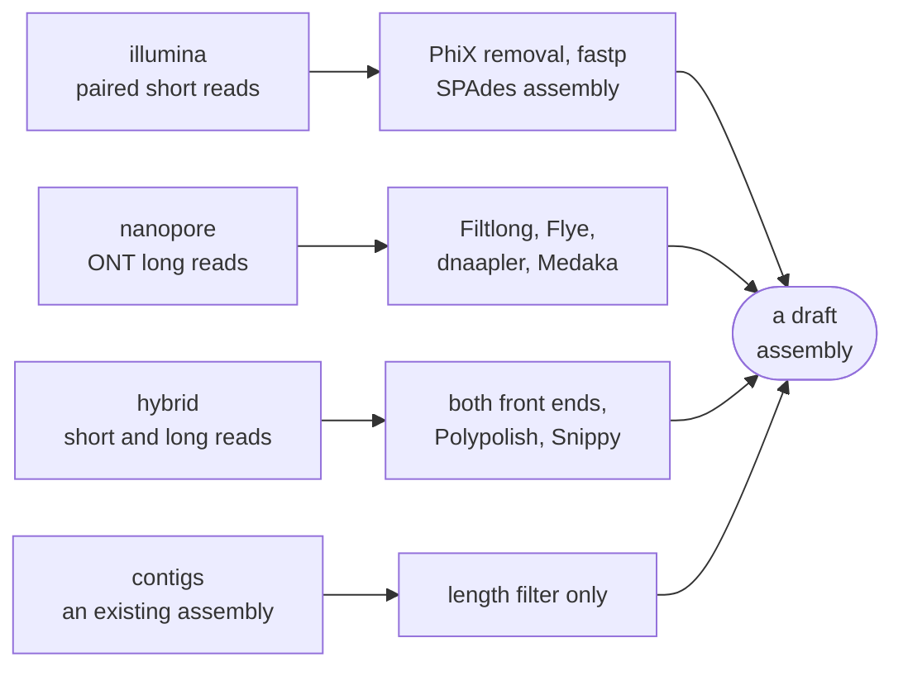
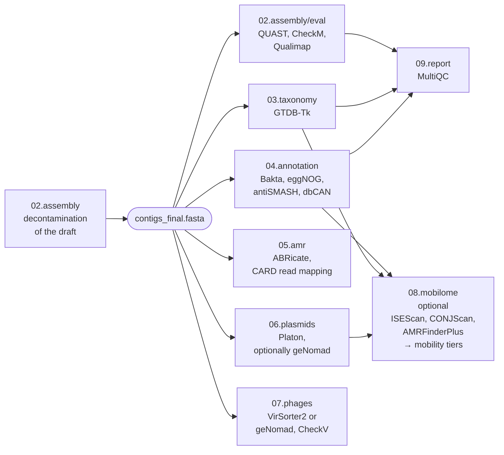
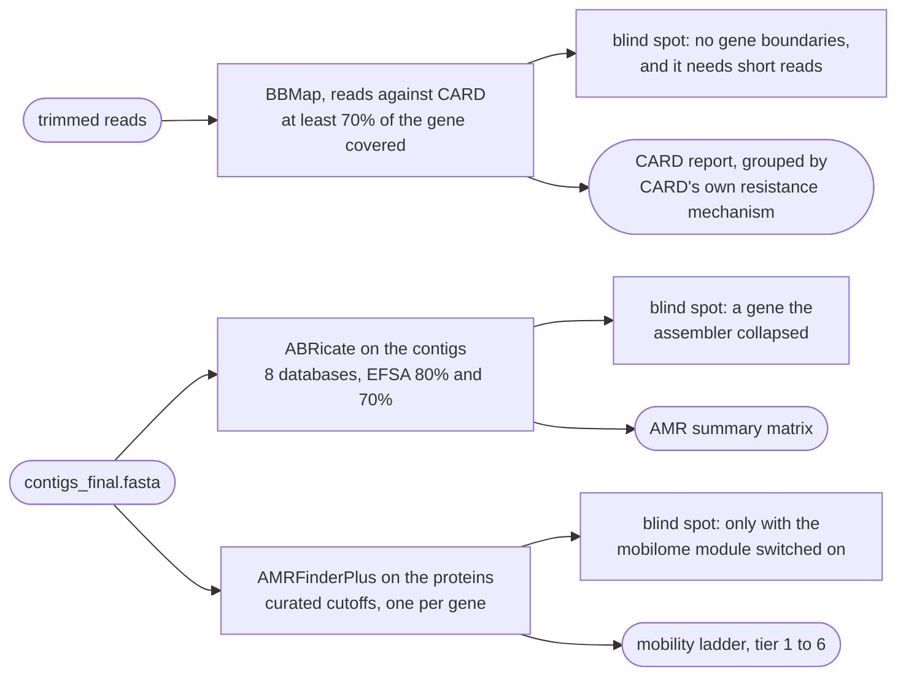

# Workflow architecture

BacFlux supports four input modes within one Snakemake workflow. The mode selects
input processing and assembly; shared rules then analyse the final assembly.
Read-dependent analyses run only when the required inputs are available.

!!! abstract "Terms used on this page"

    | | |
    |---|---|
    | **ONT** | Oxford Nanopore Technologies — the long-read sequencing platform |
    | **AMR** | antimicrobial resistance |
    | **EFSA** | European Food Safety Authority, whose thresholds the ABRicate analysis applies |

## The shape of a run

Two diagrams show the shape of a run: the first what changes with the mode, the second
the analyses every mode shares. They are schematics rather than the execution DAG: the
position of decontamination and the availability of individual rules depend on the
selected mode. For the mode-specific sequence, see [Modes](modes/index.md) and
[Decontamination](analysis/decontamination.md).

**Part 1 — what changes with the mode you chose.**



**Part 2 — the same whichever mode ran.**



The numbered output stages are shared across modes, but their individual rules
can be conditional. `08.mobilome` and its optional layers are disabled by default.
Medaka polishing runs by default in the long-read modes; `medaka_model: false` skips
it. Read QC and CARD read mapping require the corresponding reads.

!!! note "Why the entry points converge so early"

    The modes differ in what arrives — short reads, long reads, both, or contigs.
    Once a final assembly exists, the downstream rules are the same in every mode,
    and steps that need reads run only where those reads exist. Shared
    implementation also removes the maintenance differences between the earlier
    separate workflows.

    The mobilome module applies the same contig-edge flags and low-confidence caps
    in every mode; a fragmented assembly, most often a short-read one, simply
    triggers them more often — see [the mobilome overview](mobilome/index.md).

## What runs where

| stage | runs in | optional? |
|---|---|---|
| `01.reads` | every mode that has reads | — |
| `02.assembly` | all four | — |
| `03.taxonomy` | all four | — |
| `04.annotation` | all four | — |
| `05.amr` | all four; the CARD read analysis needs short reads | — |
| `06.plasmids` | all four | Platon always; the geNomad second opinion is opt-in |
| `07.phages` | all four | always runs; VirSorter2 by default, geNomad optional |
| `08.mobilome` | all four | **off by default** |
| `09.report` | all four | — |

## Complementary AMR analyses { #the-three-amr-legs-and-why-there-are-three }

The three analyses use different inputs and detection methods. ABRicate screens
the contigs, BBMap maps short reads to CARD, and AMRFinderPlus provides curated
calls for the optional mobilome analysis. Their outputs are complementary and
have different interpretation limits.



Read the detail on [the AMR page](analysis/amr.md).

## Where the files land

```text
output_dir/
├── 01.reads/       read QC reports and the PhiX genome and index (kept);
│                   trimmed, PhiX-free, filtlong-filtered reads   (temporary)
├── 02.assembly/    draft and decontaminated contigs, CheckM, QUAST
├── 03.taxonomy/    GTDB-Tk classification
├── 04.annotation/  Bakta, eggNOG, antiSMASH, dbCAN
├── 05.amr/         ABRicate tables, CARD read mapping
├── 06.plasmids/    Platon calls, optional geNomad concordance
├── 07.phages/      prophage predictions, CheckV quality
├── 08.mobilome/    mobility table                    (only when switched on)
├── 09.report/      MultiQC
└── logs/           one log per rule, per sample
```

Every path and every file is listed on [the output reference page](reference/output.md).
