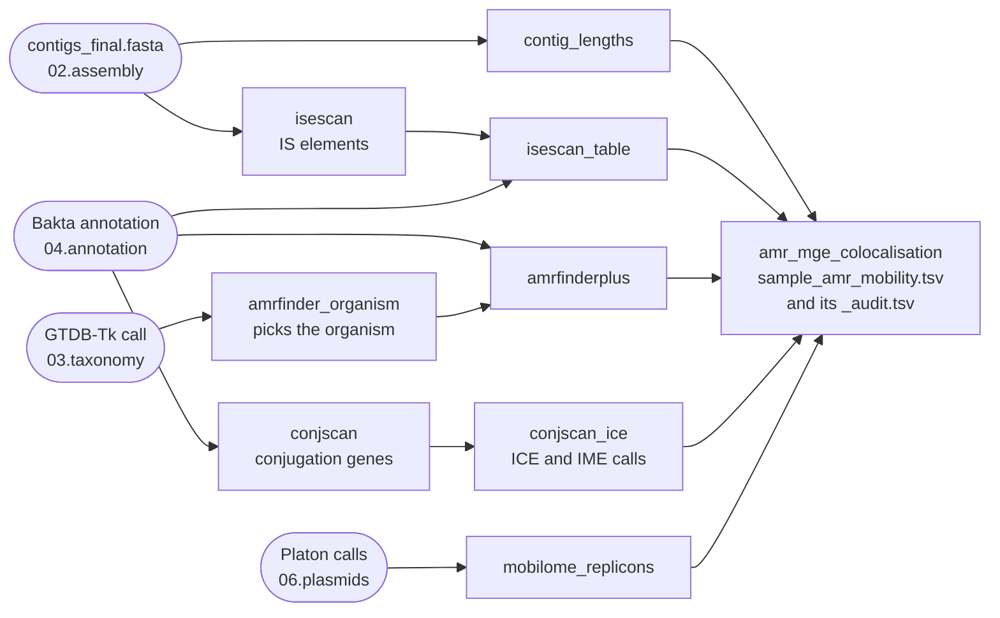

# Mobilome module

Stage `08.mobilome` combines resistance-gene calls with predicted mobile genetic
elements to describe genomic context and potential mobility. It reports one row
per assessed gene, together with confidence fields and an audit of the supporting
evidence.

The module is disabled by default. Enable it with `mobilome.run: true`; see
[Enabling the module](enabling.md). Its predictions do not demonstrate transfer,
phenotypic resistance or the intrinsic/acquired status of a gene.

!!! note "Four terms this section uses constantly"

    An **ICE** (integrative and conjugative element) sits in the chromosome and carries
    its own conjugation machinery, so it can move itself into another cell. An **IME**
    (integrative mobilisable element) sits in the chromosome and carries a **relaxase**
    — the enzyme that nicks the DNA to start a transfer — but no apparatus of its own,
    so it needs a helper element to move. An ***att* site** is the short direct repeat
    left at each end of an element where it integrated; finding the pair is how an
    element's true edges are established.

    Three more abbreviations appear throughout: **IS** is an insertion sequence, the
    smallest mobile element, carrying only the genes it needs to move itself; **CDS**
    is a coding sequence, the stretch of DNA that codes for one protein; and **EFSA**
    is the European Food Safety Authority.

## Why genomic context matters { #why-a-genes-address-matters-as-much-as-its-name }

A gene-presence result identifies sequence evidence for a determinant. It does not
establish resistance phenotype or transfer potential. A chromosomal efflux pump
carried by every member of a species and a *bla*CTX-M gene on a conjugative plasmid
give the same kind of line in an ABRicate table; only the second sits on an element
that can transfer to another cell. Strain assessment asks exactly this: whether a
resistance gene is **intrinsic** or **acquired**. Context informs that judgement but
does not, by itself, establish intrinsic or acquired resistance.

The module supplies supporting genomic evidence for the judgement, not the judgement
itself. [The mobility ladder](mobility-ladder.md) explains the six categories, the
EFSA definitions behind them, their decision order and interpretation limits.

## The mobility ladder

Every assessed gene gets exactly one tier. The label is written into the output table
next to the number, so nobody reading the TSV has to look a tier up.

| Tier | `mobility_tier_label` | Context |
|:--:|---|---|
| **1** | `intrinsic_candidate` | chromosomal, nothing mobile nearby |
| **2** | `expression_modulation_not_mobilisation` | an IS upstream, on the gene's strand — expression, **not** mobilisation |
| **3** | `composite_mobilisable_within_cell` | between two IS copies of one family: a composite transposon |
| **4** | `named_element_mobilisable` | inside a curated unit transposon or integron cassette |
| **5** | `mobilisable_needs_helper` | on a plasmid, or inside an IME |
| **6** | `predicted_self_transmissible` | inside an ICE, or on a conjugative plasmid |

Tier 5 covers every plasmid that Platon did not type conjugative, so on the plasmid
route it records plasmid context rather than demonstrated helper-dependent transfer.
`mobility_tier_label` and `plasmid_mobility` separate the cases: an IME and a plasmid
typed `mobilisable` (a relaxase or *oriT* hit) keep `mobilisable_needs_helper`; a
plasmid typed `non_mobilisable` is labelled `on_plasmid_typed_non_mobilisable`; a
plasmid without mobility typing (`unknown`, for example one called by geNomad alone)
keeps the generic label at `medium` confidence, with the audit reason
`plasmid_mobility_untyped`.

The tiers are tested top down and the first match wins, so a curated transposon *on a
plasmid* scores 5 or 6 rather than 4. That order, the three distance windows behind
it, and how far to trust each tier — tier 4 is measured on two genomes, tier 5's IME
route on none — are all on
[The mobility ladder](mobility-ladder.md).

## What runs when you turn it on

The module adds **22 Snakemake rules**, of which **10 run on the default
configuration**. The other 12 belong to four optional layers, each of which stays off
until you give it a source ([Optional layers](optional-layers.md)).

Three things follow from that picture:

- **Two new tools, both from bioconda:** [ISEScan](https://github.com/xiezhq/ISEScan)
  v1.7.3 for insertion sequences, and
  [MacSyFinder](https://github.com/gem-pasteur/macsyfinder) v2.1.6 running the CONJscan
  models for conjugation machinery. Both are given up to 8 threads per sample.
- **No new database path to configure.** AMRFinderPlus is already installed by Bakta
  and reads its database from `{bakta_db}/amrfinderplus-db/latest`; the CONJscan
  models are fetched at run time, so the machine needs network access on the first run.
- **Stage 08 consumes earlier stages rather than repeating them.** It reads the
  assembly, the Bakta proteins, GFF3 and annotation table, the GTDB-Tk species call,
  and Platon's replicon calls from `06.plasmids`.

The ICE/IME caller, the composite-transposon test and the *att*-site search run in
**all four modes**, including `illumina`. The one analysis that is mode-restricted is the
optional ISOSDB copy-number layer, which maps reads and therefore needs them —
`illumina` and `hybrid` only.

The deliverable is one row per AMR gene in `{sample}_amr_mobility.tsv`, with an audit
file beside it giving a reason for every gene left without context, every candidate
structure rejected and every confidence cap applied. Column by column:
[Reading the output](output.md).

## Why the mobilome spans three stages

Plasmids and prophages are mobile genetic elements too, so the output layout can read
as if `08.mobilome/` were "the mobilome" and `06.plasmids/` and `07.phages/` were
something else. They are not. The split is by *what question is being asked*, not by
whether the element is mobile.

| Stage | Question | Runs |
|---|---|---|
| `06.plasmids`, `07.phages` | what replicons and prophages are in this genome? (detection) | always |
| `08.mobilome` | is each AMR gene in a mobile element, and how transferable? (interpretation), plus IS, transposon, integron and ICE detection | opt-in |

For the detection stages, see [Plasmids](../analysis/plasmids.md) and
[Prophages](../analysis/phages.md).

## Why it is off by default

**Scope.** Enable the module when the analysis requires genomic context and predicted
mobility in addition to gene detection. The always-on AMR analyses — ABRicate on the
contigs, and the CARD read screen in the modes that have short reads — are unaffected by
this switch ([Antimicrobial resistance](../analysis/amr.md)).

**Cost.** Ten extra rules on the default path, three of them per-sample tool runs at
up to 8 threads, plus a one-off model download.

**Before you switch it on.** Turning the module on fetches the CONJscan model
package, which Institut Pasteur / CNRS license under **CC BY-NC-SA 4.0**. BacFlux
never ships it — you download it, under your own agreement with the licensor, exactly
as with `bakta_db` and the other user-supplied databases. Licence types for every
tool, model set and database are listed on [Licensing](../about/licensing.md).

## Three things to know before reading the output

**1. On a fragmented assembly a located IS count is a lower bound.** IS
elements are a leading cause of contig breaks: identical copies collapse in the
assembly graph, so the assembler cannot tell which flank belongs to which copy and
breaks there. The AMR gene and its flanking IS regularly land on different contigs.
Every row therefore carries `dist_to_contig_end`, `is_at_contig_boundary` and
`spans_contigs`, and the IS summary reports what fraction
of IS calls sit within 100 bp of a contig end (`mobilome.contig_boundary_bp`). Read
those before reading the counts.

**2. Never write "transmissible".** Tier 6 is `predicted_self_transmissible`, and the
prediction rests on finding conjugation machinery, not on watching a transfer happen.

**3. Confidence is tiered, never a bare call.** IS calling is imperfect even on
manually curated genomes: benchmarking four tools against a curated *E. coli*
annotation, Puterová & Martínek (2021) put the "improbable or not an IS element"
discovery rate between 0% and 23.7% depending on the tool, with **ISEScan — the caller
BacFlux uses — at 8.0%** (2.2% on their larger ISbrowser set). So every row carries
`confidence` (high / medium / low), and anything resting on a contig boundary or on a
partial hit is capped at `low`. Two predictable false calls are also removed before
anything reads the IS table: [False IS21 calls over replication genes](#false-is21-calls-over-replication-genes)
explains them.

The module was validated on closed genomes and then measured again on deliberately
fragmented ones — 40 benchmark genomes cut to ~150 kb, ~50 kb and ~20 kb N50,
re-annotated and re-run end to end:

| | closed | 150 kb N50 | 50 kb N50 | 20 kb N50 |
|---|--:|--:|--:|--:|
| curated ICEs detected (of 18) | 15 | 15 | 15 | 12 |
| median called ÷ true element length | 0.55 | 0.45 | 0.34 | 0.22 |
| ICE/IME calls at `confidence: high` | 24% | 19% | 10% | 3% |

On this benchmark the class of an element survived fragmentation better than its
extent. A low-confidence call on a draft means the assembly could not support a
stronger claim, not that the call is wrong. Which columns to read and what not to
conclude: [Draft assemblies](draft-assemblies.md).

## False IS21 calls over replication genes

**The problem.** ISEScan finds insertion sequences (IS) by looking for the proteins
they carry. One IS family, IS21, carries two: a transposase, IstA, and a helper
protein, IstB. IstB belongs to the same protein family as two of the cell's own
DNA-replication proteins (Koonin 1992; Arias-Palomo & Berger 2015):

- **DnaA**, which starts chromosome replication;
- the **replicative helicase loader**: DnaC in *E. coli*, *Salmonella*, *Klebsiella*
  and their close relatives, and DnaI in *Bacillus*, *Listeria*, *Staphylococcus*,
  *Streptococcus* and other Bacilli.

Because they look alike, two of ISEScan's IS21 models also match these genes, and
ISEScan reports "a partial IS21 element" sitting on top of them. Puterová & Martínek
(2021) found the same hits over *dnaA*, *dnaC* and *dnaI*, and Nakajima et al. (2026)
removed ISEScan calls over *dnaA* as artefacts. The calls are false: these genes are
essential (Kobayashi et al. 2003; Baba et al. 2006), so an insertion inside one would
not leave a living isolate. Left in, each call adds one IS to the counts, and it could
make a resistance gene nearby look as if it sat beside a mobile element. In BacFlux's
own runs the call over *dnaA* appeared in all 16 genomes checked, and the call over the
helicase loader in about half of the benchmark genomes.

**For *dnaA*, the gene's name is enough.** A call lying over a gene Bakta names *dnaA*
goes to `{sample}_is_discarded.tsv` with the reason `overlaps_dnaA`. On the 16 genomes
checked, this removed exactly one call per genome, the false one, and nothing else.
The call often runs on into the next genes, *dnaN* and *recF*. It is still removed,
because the test asks whether the call and the gene share at least half of whichever
is shorter: a call that holds all of *dnaA* counts even when most of it lies outside.

**For *dnaC* and *dnaI*, the name is not enough.** Bakta also gives those names to
look-alike genes that really are on mobile elements: the helicase loaders of
prophages, such as Gifsy-1 and Gifsy-2 in *Salmonella* LT2 (Słomiński et al. 2007),
loaders carried by ICEs, and even the IstB of a real IS21 element. In *E. coli* and
its relatives, every DnaC-type gene other than the chromosome's own sits inside a
phage, transposon or IS21 element (Brézellec et al. 2016). Removing every call over a
gene named *dnaC* or *dnaI* would have deleted 15 real calls in BacFlux's test data.

**Filtering criterion: conserved neighbouring genes.** The chromosome's own loader sits
next to a fixed partner gene:

- *dnaC* shares an operon with *dnaT* (Masai & Arai 1988);
- *dnaI* shares one with *dnaB*, and *nrdR* is the next gene along, 1–3 kb from
  *dnaI* (Bruand & Ehrlich 1995; Elfmann et al. 2025).

Phage and ICE loaders do not have that neighbour: in BacFlux's test data the nearest
one was over 100 kb away. So a call is removed, with the reason
`overlaps_helicase_loader`, only when all of these hold:

- ISEScan calls it a partial IS21 element;
- the call and a gene Bakta names *dnaC* or *dnaI* share at least half of whichever
  is shorter;
- that gene's partner lies within 5 kb of it;
- no IS21 transposase (*istA*) lies within 5 kb, which would mean a real IS21
  element.

[Tuning](tuning.md#the-three-contig-end-windows) gives the exact test and where its
settings live.

**Examples**

| Genome | Call over | Partner nearby? | Result |
|---|---|---|---|
| *E. coli* K-12, *K. pneumoniae* | *dnaC* | *dnaT*, right beside it | removed: a false call |
| *B. subtilis* 168 | *dnaI* | *nrdR*, 1.6 kb away | removed: a false call |
| *Salmonella* LT2 | its own *dnaC* | *dnaT*, right beside it | removed: a false call |
| *Salmonella* LT2, Gifsy-1 and Gifsy-2 prophages | the phage's own loader, named *dnaC* | no | kept: it is on a mobile element |
| *Shigella flexneri* virulence plasmid | the IstB of an IS21, named *dnaC* | no; *istA* 1.5 kb away | kept: a real IS21 element |
| *Paenibacillus* | *dnaI* | no *nrdR* nearby; the genus has another gene order | kept: the partner cannot be checked |

**What this rests on.** The protein family, the false hits and the gene order are
published (see the references below). The partner test, its 5 kb windows and the
figures that follow are BacFlux's own, measured on 176 datasets: 52 public benchmark
genomes plus validation and test runs. There, the rule removed 59 calls, all of them
false. It kept every one of the 57 real IS21 elements and every phage, ICE and
plasmid loader, and it changed no ICE call, mobility tier or confidence. About 16
false calls stay, in taxa where the partner gene is absent, such as *Paenibacillus*,
*Clostridioides* and *Aquifex*, or where a fragmented draft put it on another contig.
They stay in the IS table, as they would without the rule.

## Where to go next

| Page | What it covers |
|---|---|
| [The mobility ladder](mobility-ladder.md) | the six tiers in full, the IS-inside-CDS case, and the intrinsic-versus-acquired framing with its references |
| [Enabling the module](enabling.md) | the one switch, and what each of the four optional layers needs before it will run |
| [Optional layers](optional-layers.md) | what each layer adds, what it costs, and where its data comes from |
| [Reading the output](output.md) | every column of `{sample}_amr_mobility.tsv`, the audit trail, and the rest of `08.mobilome/` |
| [Draft assemblies](draft-assemblies.md) | what fragmentation does to a call, and which columns still hold |
| [Tuning](tuning.md) | symptoms, relevant settings and measured trade-offs |
| [Worked example](worked-example.md) | one genome end to end, with the real rows |
| [Validation](validation.md) | the ICE and IME pilots, the negative control, the head-to-head against the EBI pipeline, and what the benchmark does not show |

## References

- Arias-Palomo, E. & Berger, J. M. (2015). An atypical AAA+ ATPase assembly controls
  efficient transposition through DNA remodeling and transposase recruitment. *Cell*
  162(4), 860–871. <https://doi.org/10.1016/j.cell.2015.07.037> — IstB's ATPase is
  closest in structure to the helicase loaders DnaC/DnaI, then to DnaA.
- Baba, T., et al. (2006). Construction of *Escherichia coli* K-12 in-frame,
  single-gene knockout mutants: the Keio collection. *Molecular Systems Biology* 2,
  2006.0008. <https://doi.org/10.1038/msb4100050> — no deletion mutant of *dnaA* or
  *dnaC* could be made.
- Brézellec, P., Vallet-Gely, I., Possoz, C., Quevillon-Cheruel, S. & Ferat, J.-L.
  (2016). DciA is an ancestral replicative helicase operator essential for bacterial
  replication initiation. *Nature Communications* 7, 13271.
  <https://doi.org/10.1038/ncomms13271> — the conserved gene order around the
  chromosome's loader, and the DnaC-type genes inside mobile elements.
- Bruand, C. & Ehrlich, S. D. (1995). The *Bacillus subtilis dnaI* gene is part of the
  *dnaB* operon. *Microbiology* 141(5), 1199–1200.
  <https://doi.org/10.1099/13500872-141-5-1199>
- Elfmann, C., Dumann, V., van den Berg, T. & Stülke, J. (2025). A new framework for
  SubtiWiki, the database for the model organism *Bacillus subtilis*. *Nucleic Acids
  Research* 53(D1), D864–D870. <https://doi.org/10.1093/nar/gkae957> — the gene order
  *nrdR*–*dnaB*–*dnaI*.
- Kobayashi, K., et al. (2003). Essential *Bacillus subtilis* genes. *Proceedings of
  the National Academy of Sciences* 100(8), 4678–4683.
  <https://doi.org/10.1073/pnas.0730515100>
- Koonin, E. V. (1992). DnaC protein contains a modified ATP-binding motif and belongs
  to a novel family of ATPases including also DnaA. *Nucleic Acids Research* 20(8),
  1997. <https://doi.org/10.1093/nar/20.8.1997> — the first to place DnaC, IstB and
  DnaA in one protein family.
- Masai, H. & Arai, K. (1988). Operon structure of *dnaT* and *dnaC* genes essential
  for normal and stable DNA replication of *Escherichia coli* chromosome. *Journal of
  Biological Chemistry* 263(29), 15083–15093.
  <https://doi.org/10.1016/S0021-9258(18)68149-9>
- Nakajima, N., Jinnai, M., Okamura, A., Date, Y. & Furukawa, I. (2026). Fine-scale
  structural diversification among closely related *Legionella pneumophila* isolates
  from a bath-associated environmental reservoir. *Applied and Environmental
  Microbiology* 92(9), e01127-26. <https://doi.org/10.1128/aem.01127-26> — removed
  ISEScan calls over the *dnaA* region as artefacts.
- Puterová, J. & Martínek, T. (2021). digIS: towards detecting distant and putative
  novel insertion sequence elements in prokaryotic genomes. *BMC Bioinformatics* 22,
  258. <https://doi.org/10.1186/s12859-021-04177-6> — ISEScan's partial hits over
  DnaA, DnaC and DnaI (Additional file 7), and the IS false-discovery rates quoted
  above.
- Słomiński, B., Całkiewicz, J., Golec, P., Węgrzyn, G. & Wróbel, B. (2007). Plasmids
  derived from Gifsy-1/Gifsy-2, lambdoid prophages contributing to the virulence of
  *Salmonella enterica* serovar Typhimurium: implications for the evolution of
  replication initiation proteins of lambdoid phages and enterobacteria.
  *Microbiology* 153(6), 1884–1896. <https://doi.org/10.1099/mic.0.2006/000802-0> —
  the Gifsy prophages' loader is very similar to the host's DnaC.
