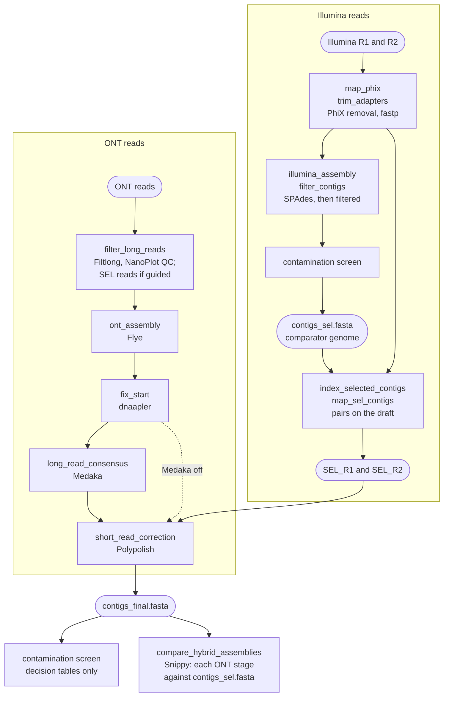

# Hybrid mode

Use `mode: hybrid` when Illumina and ONT reads are available for the same isolate.
BacFlux assembles both read types, uses the Illumina draft as a comparator, and
corrects the long-read assembly with short-read evidence. This requires more
computation than either single-technology mode.

The technologies provide complementary evidence: long reads can resolve repeats,
while high-quality short reads support correction of residual sequence errors.
Neither input is assumed to be error-free. The mode-specific rules are in
`workflow/rules/hybrid/`.

The Illumina draft is assembled and screened independently of the long-read
assembly. Reads mapping to its retained contigs are used by Polypolish and, when
`parameters.hybrid.short_read_guidance: true`, by Filtlong, which then waits for
the screen; guidance is disabled by default. The final assembly receives a separate
screen that reports decisions and removes no sequence.

!!! abstract "Terms used on this page"

    | | |
    |---|---|
    | **ONT** | Oxford Nanopore Technologies, the long-read sequencing platform |

## How the Illumina analysis filters contamination { #how-the-illumina-leg-filters-contamination }

The contamination screen runs on the **Illumina draft**, and the Illumina reads that map
as proper pairs back to the *decontaminated* draft are pulled out (`map_sel_contigs`,
keeping SAM flag `0x2`). This selects reads supported by the retained draft, without
classifying each read independently. It does not prove that every selected read
belongs to the intended organism. Polypolish uses these reads for correction.

Whether it also filters the long reads is a setting, `parameters.hybrid.short_read_guidance`:

- **`false`, the default.** Filtlong selects the long reads on length and quality alone,
  as in `nanopore` mode, so nothing removes contaminant long reads before Flye. The
  delivered genome is screened again afterwards instead, as a check that changes no
  contig: see [the second screen in `hybrid`](../analysis/decontamination.md#the-second-screen-in-hybrid).
- **`true`.** The pairs are handed to Filtlong as `-1/-2`. Filtlong then also asks how
  much of each long read is supported by k-mers from these trusted short reads. A long
  read from a contaminant has no such support, so one step does the quality filtering
  and the decontamination together.

!!! warning "With short-read guidance on, a contig dropped by the screen takes its long reads with it"

    The consequence runs further than the taxonomy table. If the contamination screen
    removes a genuine contig — a small broad-host-range plasmid is the case that
    happens, see [Decontamination](../analysis/decontamination.md) — the reads
    covering it are absent from the Filtlong reference, the ONT reads covering it
    score as low quality, and the sequence never reaches Flye at all. It disappears
    from the assembly rather than merely from the taxonomy.

    This is independent of the Filtlong settings below. Both can delete a plasmid, for
    different reasons, and both are worth ruling out.

The Filtlong flags differ from `nanopore` mode on purpose:

| Flag | From | Default | Why it differs here |
|---|---|---|---|
| `--min_length` | `parameters.long_read_qc.min_length` | 1000 | same as `nanopore` |
| `--keep_percent` | `parameters.long_read_qc.keep_percent` | 95 | same key, same effect on small plasmids ([Nanopore mode](nanopore.md)) |
| `--length_weight` | `parameters.long_read_qc.length_weight` | 1 | **only reaches Filtlong here.** At 10 the 1–3 kb read band is emptied whatever `keep_percent` says |
| `--trim`, `--split 1000` | `short_read_guidance: true` only | — | cut unsupported read ends, and break a read at any unsupported 1 kb stretch — how a chimeric read is separated |
| `--target_bases` | `short_read_guidance: false` only | 500 Mbp | the coverage cap `nanopore` mode applies; with guidance on, the short reads define what is worth keeping, so no cap is passed |

## Two genomes, and which one is delivered

The ONT assembly is the deliverable. The Illumina assembly is not a by-product: it is
what the screen runs on, it is the source of the clean read set, and it is kept as the
comparator genome.

| | Built from | Role |
|---|---|---|
| `contaminants/contigs_sel.fasta` | SPAdes, decontaminated | comparator: QUAST, CheckM and GTDB-Tk all evaluate it too, and Snippy uses it as the reference |
| `contigs_final.fasta` | Flye → dnaapler → Medaka\* → Polypolish | **the delivered genome**, annotated by every downstream stage |

`{sample}_qc_genomes.tsv` in `02.assembly/{sample}/eval/` says which is which. In the
MultiQC report the two appear as separate rows — `completeness Illumina | {sample}` and
`completeness ONT | {sample}`.

The two FASTAs have entirely different contig names, because the screen ran on one and
the delivered genome came from the other. That is expected, and it is why the plasmid
stage gets a second BLAST table of `contigs_final.fasta` to look contigs up by ID.

## Medaka

The long-read arm polishes with Medaka exactly as [Nanopore mode](nanopore.md) does.
`check_medaka_model` resolves the model, or validates `parameters.hybrid.medaka_model`,
and downloads its weights before Flye starts, so a bad model fails in seconds and the
polishing job needs no internet. Medaka runs with `-x`, rebuilding its index of the
draft every time. `parameters.hybrid.medaka_model: false` skips it; Polypolish then
corrects the reoriented assembly directly.

## Polypolish

`short_read_correction` aligns each mate **separately** with `bwa mem -a` — all
alignments, not just the best — because Polypolish needs to see every place a read
could have come from. `polypolish filter` then drops alignments inconsistent with the
insert size, which is what makes correction inside repeats safe, and `polypolish
polish` writes the corrected sequence.

Polypolish always runs, whether or not Medaka did, so this mode needs no
`finalize_contigs` step: its last rule is unconditional.

## The Snippy comparison

`compare_hybrid_assemblies` aligns **four** stages of the ONT genome against the
Illumina assembly and counts the variants: the raw Flye assembly, the reoriented one,
the Medaka consensus, and the Polypolish-corrected genome. In a well-behaved run
the variant count falls towards zero from the Flye assembly to the corrected
genome. The Illumina assembly is a comparator, however, not an independently
validated truth sequence.

The digest is `02.assembly/{sample}/snps/SNPs_summary.txt`, with the four Snippy
directories beside it. With Medaka off, stage `03` holds a `skipped.txt` instead.

!!! note "A variant count of zero does not mean two assemblies are identical"

    Snippy reports small variants in **aligned** regions only. Contig joins,
    structural differences and unaligned sequence are invisible to it, so the summary
    has to be read together with the contig count and the assembly size. The rule
    prints that caveat into the file itself.

## What it writes

Everything `illumina` and `nanopore` write, plus:

| Path | Contents |
|---|---|
| `01.reads/{sample}/illumina/{sample}_sel_R{1,2}.fastq` | the decontaminated Illumina pairs. Kept, not temporary — they are a useful deliverable, and deleting them would drag SPAdes and the whole screen back through the DAG to recreate them |
| `02.assembly/{sample}/polypolish/` | empty at the end; every file in it is temporary |
| `02.assembly/{sample}/snps/` | the four Snippy runs and `SNPs_summary.txt` |
| `02.assembly/{sample}/contaminants/{sample}_final_blastout` | the second BLAST, over the delivered genome, for the plasmid stage |

Environments built: everything `illumina` and `nanopore` need, plus polypolish and
snippy. Bowtie2 builds the coverage track of the screen on the Illumina draft; minimap
maps the long reads for the second screen, over the delivered genome.
