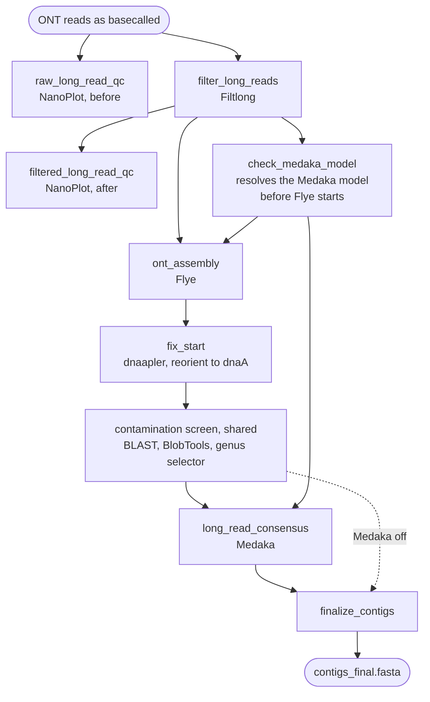

# Nanopore mode

Use `mode: nanopore` for Oxford Nanopore Technologies (ONT) reads. The workflow
filters reads, assembles with Flye, reorients circular contigs and screens for
contamination. Medaka polishing is optional. The mode-specific rules are in
`workflow/rules/nanopore/`.

There is no PhiX step: PhiX is an Illumina spike-in and does not exist in an ONT
library. The Medaka model is resolved *before* Flye runs, so a bad model name costs
seconds rather than an hour of assembly — see
[the model-choice note](../methods_medaka_model.md).

!!! abstract "Terms used on this page"

    | | |
    |---|---|
    | **CARD** | Comprehensive Antibiotic Resistance Database |

## 1. Read filtering { #1-read-filtering-and-why-it-is-the-biggest-lever-in-this-mode }

ONT read length, quality and depth vary between datasets. Filtlong reduces the
input according to length, quality and total bases. Filtering can reduce assembly
cost, but may also remove reads from small plasmids. The rule
`filter_long_reads` uses these settings:

| Flag | From | Default | What it does |
|---|---|---|---|
| `--min_length` | `parameters.long_read_qc.min_length` | 1000 | removes reads shorter than the threshold |
| `--keep_percent` | `parameters.long_read_qc.keep_percent` | 95 | keeps the best N% of the remaining bases, by Filtlong's own score |
| `--target_bases` | fixed at 5×10⁸ | — | limits input to about 100× for a 5 Mbp genome |

!!! warning "`keep_percent` is what decides whether a small plasmid survives"

    Filtlong ranks reads by a blend of length and quality, and `keep_percent`
    discards the bottom of that ranking. A small plasmid cannot produce reads longer
    than itself, so its reads sit near the bottom by construction and go first.

    Measured on *K. pneumoniae* TUM24772, whose 5,596 bp Col2 plasmid was missing
    from the assembly while sitting complete in the Illumina data: of the 603 raw ONT
    reads covering it, **93** survived the old `keep_percent: 90`, and **500** survive
    the 95 that now ships. Recovering the reads was necessary but not sufficient — no
    setting tried, raw unfiltered reads included, assembled that plasmid.

    `parameters.long_read_qc.length_weight` has **no effect in this mode**: this rule
    passes no `--length_weight`, so Filtlong uses its own default of 1. That key
    reaches Filtlong in `hybrid` mode only.

NanoPlot runs on both sides of the filter — `01.reads/{sample}/ont/raw_qc/` and
`filt_qc/` — so what the filter removed is visible rather than assumed. Read the two
side by side. Its plots are interactive HTML pages, gathered in
`{sample}_NanoPlot-report.html`. It writes no PNG images (`--no_static`), which would
need a Chrome browser on the computer running the job. The HTML plots load their
plotting library from the internet when you open them.

## 2. The Medaka model is resolved before anything is assembled

`check_medaka_model` (a shared rule) runs straight after read filtering, validates
`parameters.nanopore.medaka_model` or infers it from the basecaller tag in the read
headers, and writes the result to `{sample}_medaka_model.txt`: the model's name, or in
`auto` mode the path to its weights file. The assembler waits on that file. A typo
therefore fails in seconds with a table of suggestions, instead of an hour later when
Flye has already finished.

The check also puts the model's weights on disk. Medaka ships the weights of only a
few models and downloads the rest from GitHub the first time they are needed; `auto`
inference downloads them as part of resolving the model, and an explicit name is
followed by `medaka tools download_models`. The check is a *local rule*: on a cluster
it runs on the computer that runs Snakemake, not on a compute node, so the polishing
job itself needs no internet.

| `medaka_model` | Effect |
|---|---|
| `auto` (default) | infer from the FASTQ headers; fails with suggestions if they carry no tag |
| an explicit name | validated against the installed model list |
| `false` | Medaka is skipped, and the rule is not defined at all |

Which model `auto` resolves to, why it is the bacterial variant, and when to pin a
different one, are in [The Medaka polishing model](../methods_medaka_model.md).

!!! note "Setting the model also changes the assembler"

    With `parameters.nanopore.flye_input_mode: auto` (the default), Flye's read mode
    is derived from the Medaka model name: a name containing **fast** selects
    `--nano-raw`, anything else `--nano-hq`. Fast basecalling means noisier reads, so
    the coupling is deliberate — but it means a change of polisher model silently
    changes the assembly. Set `flye_input_mode` explicitly to pin one without the
    other. The reasoning is under
    [Long-read assembly and polishing](../reference/configuration.md#long-read-assembly-and-polishing-nanoporehybrid).
    The cases where model inference fails are on the Medaka page linked above.

## 3. Assembly and reorientation

`ont_assembly` runs Flye with `--iterations 5` of its own internal long-read
polishing. Long reads can span repeats that fragment short-read assemblies. The resulting
contiguity and circularity depend on read quality, depth and genome structure;
check Flye's topology calls and assembly QC rather than assuming closure.

A circular sequence has no natural start, and Flye's arbitrary one makes two
assemblies of the same isolate look different. `fix_start` runs `dnaapler all`, which
searches every contig for the canonical start genes at once — *dnaA* for a
chromosome, *repA* for a plasmid, *terL* for a phage — and rotates the sequence to
begin there. It runs at a fixed seed, so a re-run is reproducible.

Two by-products are used later:

- `ignore_list.txt`, written from Flye's `assembly_info.txt`, lists the contigs Flye
  did **not** call circular. Rotating a linear contig would move its true ends into
  the middle, so dnaapler is told to leave those alone.
- `{sample}_all_reorientation_summary.tsv` records which start gene was found on each
  contig and how convincingly. Together with Flye's circularity column it builds the
  `--replicons` table handed to Bakta, so the annotation knows which sequences are
  closed chromosomes and can call a gene that runs across the origin.

Headers are trimmed to their first whitespace token here, because Bakta, Platon,
geNomad and the BLAST screen all join on that token.

## 4. Order: screen first, polish second

The contamination screen runs on the **reoriented** assembly, and Medaka polishes the
**decontaminated** one. Polishing a contaminant contig with this isolate's reads would
use computation on sequence intended for removal.

Medaka runs with `-x`, which rebuilds its two index files of the draft (`.fai` and
`.map-ont.mmi`, written beside the draft in `contaminants/`) every time it runs. The
screen rewrites that draft whenever it runs again, so rebuilding is what keeps the
index describing the contigs actually being polished. It takes seconds.

`finalize_contigs` then copies whichever file ended the chain — the Medaka consensus,
or the decontaminated assembly when Medaka is off — to `contigs_final.fasta`, and logs
which one it copied. That one line is the provenance of the delivered genome.

## What this mode has that the short-read modes do not

- **Topology.** Flye's circularity calls reach Bakta, so closed replicons are
  annotated as closed.
- **Contiguity.** The mobilome module's element boundaries are far more meaningful on
  a closed genome; on a draft the class survives fragmentation but the extent does
  not ([Draft assemblies](../mobilome/draft-assemblies.md)).

## What it gives up

- **No read-based CARD screen.** That analysis needs short reads. ABRicate on the contigs
  still runs ([Antimicrobial resistance](../analysis/amr.md)).
- **No length or coverage filter on the contigs.** The reoriented assembly reaches the
  screen as Flye left it.
- **Residual base errors** are what Medaka fixes; switching it off leaves them in.
  Residual indels, including those in homopolymers, can disrupt gene prediction.

## What it writes

| Path | Contents |
|---|---|
| `01.reads/{sample}/ont/raw_qc/`, `filt_qc/` | NanoPlot, before and after filtering |
| `01.reads/{sample}/ont/{sample}_filt.fastq` | the reads Flye assembled and Medaka polished |
| `02.assembly/{sample}/flye/` | `assembly.fasta`, `assembly_info.txt`, `ignore_list.txt` |
| `02.assembly/{sample}/fix_start/` | dnaapler's output and the reorientation summary |
| `02.assembly/{sample}/medaka/` | `consensus.fasta` (absent when Medaka is off) |
| `02.assembly/{sample}/{sample}_replicons.tsv` + `_audit` | the table Bakta is given, and the reason per contig |
| `02.assembly/{sample}/contigs_final.fasta` | the delivered genome |
